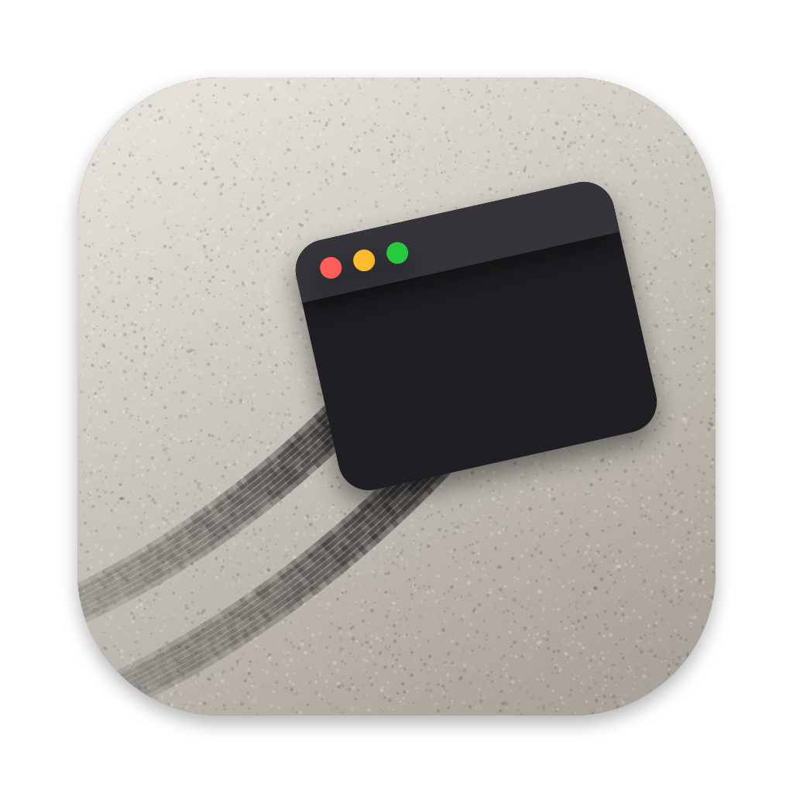
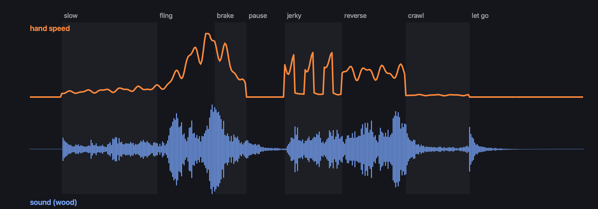

<p align="center">
  
</p>

<h1 align="center">Screech</h1>

<p align="center">
  <b>Drag a window and hear it drag.</b><br>
  A tiny macOS menu bar app that makes your windows sound like real objects<br>
  sliding across wood, metal, stone, glass and rubber.
</p>

<p align="center">
  <a href="https://github.com/kiddin/drag/releases/latest"><b>Download</b></a> ·
  <a href="#try-it">Install</a> ·
  <a href="#how-it-works">How it works</a>
</p>

https://github.com/user-attachments/assets/04563d20-4ee6-4566-8635-ee8d123834a8

<p align="center"><sub>Sound on. Rendered by the app's own engine: five drags, then a rubber and a metal resize.</sub></p>

---

## Try it

1. Download **[Screech-v1.0.0.zip](https://github.com/kiddin/drag/releases/latest)** and unzip it.
2. In Terminal, in the unzipped folder, run `./install.sh`.
3. Drag any window. Pick a material from the waveform icon in the menu bar.

The release is signed ad hoc, not notarized, so `install.sh` removes the download quarantine for you. Prefer building it yourself? `make install` does the same from source.

Works on macOS 15 or newer, Apple Silicon and Intel.

## It follows your hand

The sound isn't a loop that starts and stops. It tracks how you move:

- **Drag faster** and it gets louder and brighter.
- **Hesitate** and it stutters.
- **Stop** and it goes quiet, even with the button still down.
- **Let go** and you hear the window being set down.

<p align="center"></p>

<p align="center"><sub>One scripted drag on wood: hand speed on top, sound below.</sub></p>

## Materials

| | Drag | Resize |
|---|---|---|
| **Wood** | Furniture dragged over a floor | Slow creak |
| **Rubber** | A box squeaking along on rubber feet | Balloon screech that rises as you stretch |
| **Metal** | A metal stool pushed across a floor | Groaning squeal that rings out |
| **Glass** | A glass bowl sliding on a countertop | Wet-finger squeak |
| **Stone** | A stone slab grinding over tiles | Rumbling grind |

Drags play real recordings. Resizes and knocks are synthesized from a physical model of the material.

## The menu

| Control | Default | What it does |
|---|---|---|
| Material | Wood | The sound theme |
| Try drag / Try resize | | Plays a scripted gesture so you can hear a material without moving a window |
| Volume | 70% | Overall loudness |
| Ring | 100% | How much the material resonates on resize and knocks: left is dry, right rings |
| Reverb | 35% | A small room around the sound |
| Drag sounds / Resize sounds | On | Turn either kind off |
| Launch at login | Off | Start Screech when you log in |

## Private by construction

- **No network.** Screech contains no networking code and never checks for updates.
- **No permissions.** No Accessibility, no Screen Recording, no Input Monitoring, no microphone. It only sees which mouse button is down and where windows are, both of which macOS shares with any app.
- **No telemetry.** The only thing it stores is its own preferences, in `~/Library/Preferences/dev.screech.Screech.plist`.
- **Idle means idle.** Nothing runs between clicks: no timers, no polling. The audio engine starts when you grab a window and pauses 20 seconds later.

## How it works

<details>
<summary><b>Watching windows</b></summary>

A global mouse monitor reports button presses (this needs no permission, unlike keyboard monitoring). It listens for presses only, and its handler just notes where the press was and hands off to a background queue, so it never holds up the event stream that other input drivers, such as Wacom's, share.

On a press, Screech finds the window under the pointer in `CGWindowListCopyWindowInfo` and samples that one window's bounds until the button comes up; it reads the release from the button state, not from another event. A press on the title bar, toolbar or an edge, where windows are moved and resized, is sampled 60 times a second. A press in the content (drawing, selecting text) is sampled 10 times a second and speeds up only if the window actually starts moving; after a second without movement it slows down again. Window *bounds* are public; titles and contents, which would need Screen Recording, are never read.

`MotionAnalyzer` turns those frames into a gesture:

1. **Drag or resize.** If the size changed, it is a resize; if only the origin moved, a drag. The first motion decides, so a drag that crosses screens never flips to resize.
2. **Speed.** Measured between frames that actually changed, so a repeated frame never reads as a stop. Speed falls to zero after 50 ms without movement (90 ms for resizes).
3. **Bumps.** A sharp reversal of direction triggers a knock.
4. **Pan and weight.** The window's position across all screens pans the sound; bigger windows make knocks and squeals lower.

</details>

<details>
<summary><b>Making the sound</b></summary>

Everything runs on the audio thread with no locks and no allocation; the tracker talks to it through atomics.

- **Drag** plays the material's recording as overlapping 160 ms grains taken from random places, so it never audibly loops. The playback rate follows your speed, from 0.7x at a crawl to 1.45x on a fling, the way a real object sounds lower and duller when pushed slowly. A low-pass filter opens with speed too.
- **Resize** is a bowed-string friction model (the stick-slip that makes a wet finger squeal on glass): speed sets pitch and pressure, and growing bends the pitch up while shrinking bends it down.
- **Knocks** on grab, release and direction reversals are short contact pulses into a bank of up to 48 resonant modes, laid out like a real plate of the material.
- **Room.** An 8-line feedback delay network reverb, a gentle compressor and a soft clipper.

</details>

<details>
<summary><b>The recordings</b></summary>

All five are public domain (CC0) from freesound.org; [`Resources/Samples/CREDITS.md`](Resources/Samples/CREDITS.md) lists each one and its author. `scripts/prepare_samples.py` keeps only the steady dragging parts of each, removes pauses and stray knocks, and evens out the loudness.

</details>

## Uninstall

```bash
make uninstall
```

This quits Screech, removes its login item and deletes the app. Your preferences stay; remove them with `defaults delete dev.screech.Screech`.

If you installed from the zip, quit Screech from its menu and drag `Screech.app` from Applications to the Trash.

## Development

Needs Swift 6 or newer (Xcode 16 or newer, or its Command Line Tools).

```bash
make install    # build, copy to Applications and launch
make run        # build and run it from the terminal
make test       # DSP, motion analysis and recording playback tests
make previews   # render previews/<material>-{drag,resize}.wav from a scripted gesture
make demo       # render docs/demo.mp4 and docs/hand.png (needs ffmpeg)
make release    # tests, then dist/Screech-vX.Y.Z.zip
make icon       # redraw Resources/AppIcon.icns
```

```
Sources/ScreechDSP/      pure Swift, unit tested: motion analysis, synth, recording playback
Sources/Screech/         the menu bar app: window tracking, audio output, menu
Sources/screech-render/  offline renderer for previews, the demo and loudness checks
Tests/ScreechDSPTests/   synthetic drags and resizes, silence, bounds, materials
Resources/Samples/       one drag recording per material
scripts/                 icon, demo and recording preparation
```
